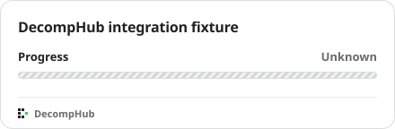
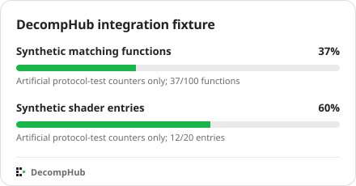

# DecompHub progress integration fixture

This repository exists only to test the reporting protocol. Every count is synthetic. It is not a reconstruction or decompilation project and must not be included in a public project catalogue.

[Progress data](decomphub.progress.json)

The test uses a separate database and temporary endpoint. No application source, account data, credentials or upstream project content is stored here.

## Completed test — October 12, 2026 (Minsk)

[PR #1](https://github.com/amnios-dev/decomphub-progress-e2e/pull/1) merged report changes. [GitHub Actions run 38184530280](https://github.com/amnios-dev/decomphub-progress-e2e/actions/runs/38184530280) verified the merged public JSON and received HTTP 202 from the isolated test instance.

The real collector then made two public source requests, recorded the separate 37/100 and 12/20 test ratios, and updated the served SVG. The unmeasured track stayed non-numeric. Repeating collection made no new requests. Changed and unchanged ETag checks returned 200 and 304; HEAD, track selection, the one-hour hint cooldown and rejection of a submitted percentage passed.

These are saved test outputs, not live project progress:

Before:

After:

The temporary notification URL was removed and the test workflow disabled after verification. No production catalogue entry was created. The application source remains private.
